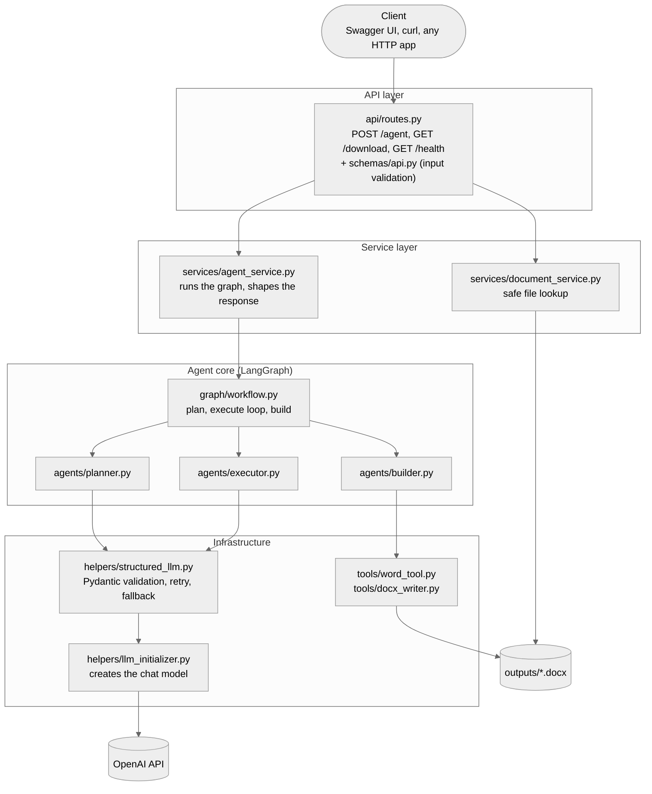
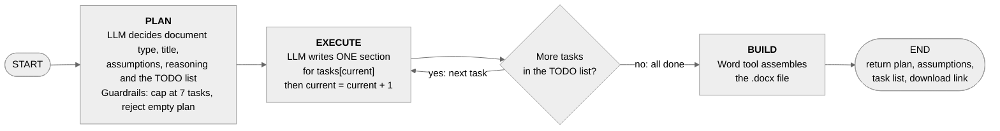
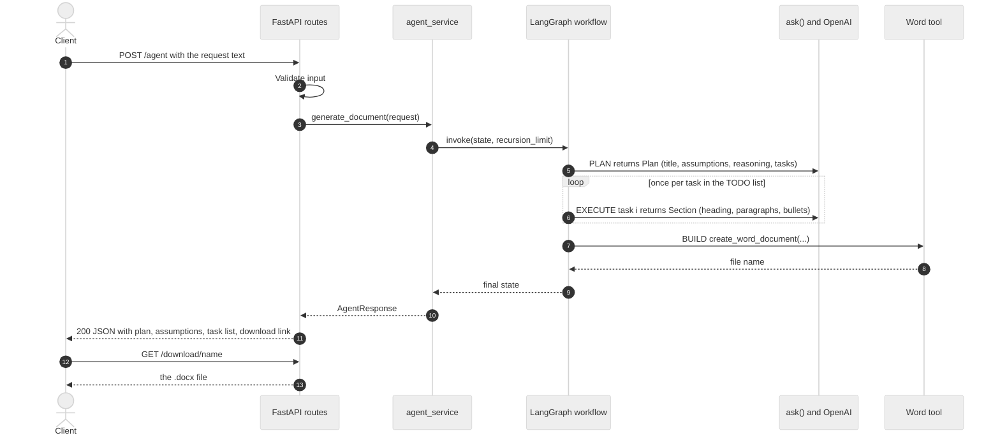
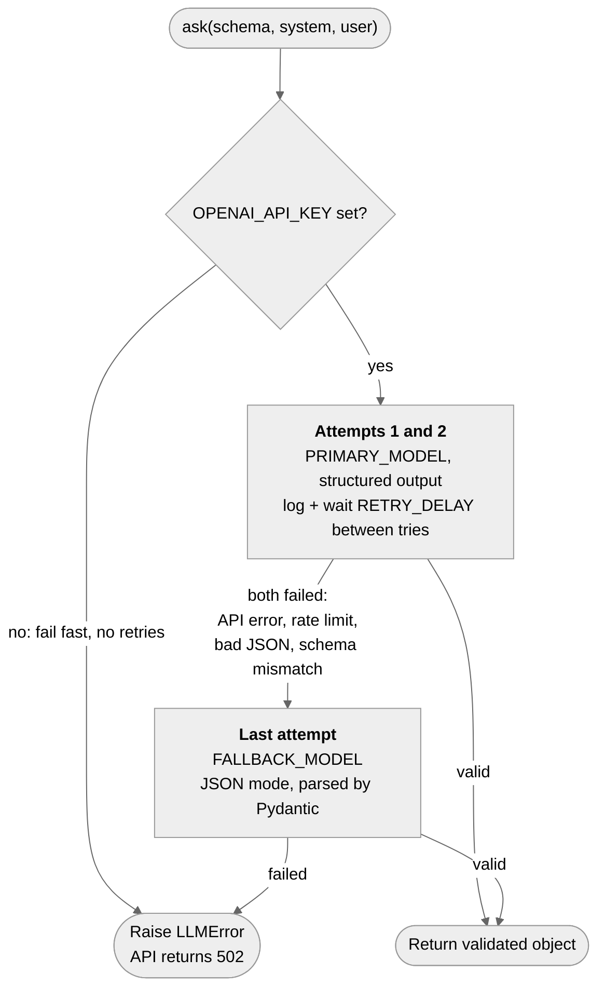

# Autonomous Document Agent

> Send a plain-English request, get a finished Word document. An LLM agent **plans its own TODO list**,
> executes it step by step, and builds a polished `.docx`, exposed through a FastAPI service.


## Contents

1. [Overview](#overview)
2. [Architecture](#architecture)
3. [Agent workflow](#agent-workflow)
4. [Request lifecycle](#request-lifecycle)
5. [Reliability: retry and fallback](#reliability-retry-and-fallback)
6. [API reference](#api-reference)
7. [Configuration](#configuration)
8. [Getting started](#getting-started)
9. [Test inputs and demo](#test-inputs-and-demo)
10. [Testing and quality](#testing-and-quality)
11. [Project structure](#project-structure)
12. [Design decisions and tradeoffs](#design-decisions-and-tradeoffs)
13. [Assignment checklist](#assignment-checklist)
14. [Limitations and roadmap](#limitations-and-roadmap)

## Overview

`POST /agent` accepts a request such as *"Create a project plan for launching a mobile app in 3 months with a
5-person team."* The agent then:

1. **Plans**: picks the document type and title, states assumptions for missing information, explains how it
   resolved conflicting requirements, and writes its own TODO list (4 to 7 sections).
2. **Executes**: writes the document one section at a time, looping until its TODO list is done.
3. **Builds**: turns the finished sections into a `.docx` using a Word tool.
4. **Responds** with the plan, assumptions, task list and a download link.

**Highlights**

- Autonomous planning: the LLM decides *what* to write; the code only controls *how* it is executed.
- Typed end to end: every LLM reply is validated against a Pydantic schema.
- Reliable: retry plus a fallback strategy around every LLM call.
- Guarded: input validation, task cap, recursion limit, safe downloads.
- Maintainable: layered structure, single-purpose modules, 27 offline tests, lint-clean, CI and Docker included.

## Architecture

The code is split into layers. Dependencies point **downward only**: the API never talks to the LLM directly, and
agents never touch HTTP.



| Layer | Folders | Responsibility |
|---|---|---|
| API | `api/`, `schemas/api.py` | HTTP endpoints, input validation, mapping errors to status codes. No business logic. |
| Service | `services/` | Use cases: run the agent and shape the response, look up files safely. |
| Agent core | `graph/`, `agents/` | The LangGraph workflow and the three agents: planner, executor, builder. |
| Infrastructure | `helpers/`, `tools/` | LLM access with retry and fallback; Word document generation. |
| Shared | `core/`, `schemas/document.py`, `schemas/state.py` | Settings, exceptions, logging, data models. |

**Key design rules**

- One entry point for LLM calls: `helpers/structured_llm.ask()`. Agents never create models themselves.
- One place that creates models: `helpers/llm_initializer.get_llm()`.
- One place for settings: `core/config.py`, overridable from `.env`.
- Document generation has no AI in it (`tools/docx_writer.py`), so it is deterministic and unit-testable.

## Agent workflow

The agent is a LangGraph state machine: `plan`, then a loop of `execute`, then `build`.



| Step | What happens | Writes to state |
|---|---|---|
| **plan** | LLM returns a `Plan`. Code caps it at `MAX_TASKS` and rejects an empty plan. | `doc_type`, `title`, `reasoning`, `assumptions`, `tasks`, `current = 0` |
| **execute** | LLM writes one `Section` for `tasks[current]`, given the headings already written so it does not repeat itself. | `sections` (appended), `current + 1` |
| **route** | If `current < len(tasks)` go back to `execute`, otherwise go to `build`. | nothing |
| **build** | The Word tool assembles the file. | `doc_path` |

The shared state (`schemas/state.py`) is the only thing nodes communicate through:

| Field | Written by | Meaning |
|---|---|---|
| `request` | API | The user's original request |
| `doc_type`, `title`, `reasoning` | planner | What the agent decided to produce, and why |
| `assumptions` | planner | Assumptions for missing information and resolved conflicts |
| `tasks` | planner | The agent-generated TODO list: `{id, section, goal}` |
| `current` | planner, executor | Index of the task being worked on |
| `sections` | executor | Finished sections. Uses an **append reducer**, so nodes return only the new section and never mutate shared state |
| `doc_path` | builder | File name of the generated `.docx` |

## Request lifecycle



## Reliability: retry and fallback

This is the project's **mandatory engineering improvement**. Every LLM call in the project goes through
`helpers/structured_llm.ask()`.



- **What:** Pydantic validates every reply, so a malformed or schema-breaking answer counts as a failure. The
  primary model is retried, then a last attempt uses a different strategy (plain JSON mode) on `FALLBACK_MODEL`.
  Each failure is logged. If everything fails, a single `LLMError` is raised.
- **Why:** LLM calls fail in ordinary ways: rate limits, timeouts, malformed JSON, replies that do not match the
  schema. In a multi-step agent, one failed call would otherwise crash the whole run after several successful ones.
- **Impact:** one bad response no longer fails the request. Because the fallback changes the *strategy*, it also
  helps when `FALLBACK_MODEL` equals `PRIMARY_MODEL` (the default). Set a different `FALLBACK_MODEL` to add a true
  model fallback.
- **Configuration errors fail fast.** A missing `OPENAI_API_KEY` raises immediately instead of wasting retries.

| Failure | Result |
|---|---|
| Invalid input (too short, blank, wrong type) | `422` |
| LLM failed after all attempts, or the plan was unusable | `502` |
| Any other unexpected error | `500` |
| Download of a missing, non-`.docx` or path-traversal name | `404` |

## API reference

Interactive docs are served at `/docs` (Swagger UI).

| Method | Path | Description |
|---|---|---|
| `POST` | `/agent` | Plan, write and build a document from a request |
| `GET` | `/download/{name}` | Download a generated `.docx` |
| `GET` | `/health` | Liveness check, returns `{"status": "ok"}` |

**Request**

```json
{ "request": "Prepare a proposal for a client. I don't know their industry or budget. They want it ready fast but also very detailed. Include risks and a timeline." }
```

Validation: 10 to 2000 characters, whitespace is trimmed, blank text is rejected.

**Response** (illustrative shape; the content varies on every run)

```json
{
  "message": "Created 'Client Proposal' (proposal) with 6 sections.",
  "doc_type": "proposal",
  "plan_reasoning": "A proposal fits a client-facing request. 'Fast but detailed' was resolved with a concise executive summary plus detailed appendices.",
  "assumptions": [
    "Industry is unknown, so a generic B2B services context is assumed.",
    "Budget is unknown, so three indicative pricing tiers are offered."
  ],
  "task_list": [
    { "id": 1, "section": "Executive Summary", "goal": "Give a one-page overview of the offer" },
    { "id": 2, "section": "Risks and Mitigations", "goal": "List key risks with mitigations" }
  ],
  "document": "3f9a1c2e.docx",
  "download_url": "/download/3f9a1c2e.docx"
}
```

## Configuration

All settings live in `core/config.py` and can be overridden from `.env`. See [`.env.example`](.env.example) for
the fully commented template.

| Variable | Default | Purpose |
|---|---|---|
| `OPENAI_API_KEY` | none (required) | OpenAI credentials |
| `PRIMARY_MODEL` | `gpt-6-luna` | Model for the first attempts of each call |
| `FALLBACK_MODEL` | same as primary | Model for the last-resort attempt |
| `MAX_ATTEMPTS` | `3` | Total attempts per LLM call |
| `RETRY_DELAY` | `1` | Seconds between failed attempts |
| `MAX_TASKS` | `7` | Cap on the agent's TODO list |
| `RECURSION_LIMIT` | `50` | LangGraph hard stop for runaway loops |
| `OUTPUT_DIR` | `outputs` | Where `.docx` files are written |

## Getting started

**Prerequisites:** Python 3.10+ and an OpenAI API key.

```bash
python -m venv venv && source venv/bin/activate      # Windows: venv\Scripts\activate
pip install -r requirements.txt
cp .env.example .env                                  # then put your OPENAI_API_KEY in .env
uvicorn main:app --reload
```

Open <http://127.0.0.1:8000/docs>, expand **POST /agent**, click **Try it out** and send a request.

**With Docker**

```bash
cp .env.example .env                                  # add your OPENAI_API_KEY
docker compose up --build
```

**Make shortcuts** (`make help` lists them): `make install`, `make run`, `make test`, `make demo`, `make lint`.

## Test inputs and demo

Two inputs are provided in `samples/`:

| Sample | What it exercises |
|---|---|
| `standard.json` | A clear request: *"Create a project plan for launching a mobile app in 3 months with a 5-person team."* |
| `complex.json` | An ambiguous request: unknown industry and budget, conflicting *"fast but very detailed"*, must include risks and a timeline. The agent has to state assumptions and resolve the conflict. |

```bash
python run_demo.py
```

Runs both inputs through the API in-process, prints the planning rationale, assumptions and agent-generated task
list, and saves the JSON responses and Word files to `demo_results/`. Or call the running server directly:

```bash
# Generate each document and save the API response as 2-space-indented JSON (without printing it).
set -o pipefail
curl -fsS -X POST http://127.0.0.1:8000/agent -H "Content-Type: application/json" -d @samples/standard.json | python3 -m json.tool --indent 2 > standard-response.json
curl -fsS -X POST http://127.0.0.1:8000/agent -H "Content-Type: application/json" -d @samples/complex.json | python3 -m json.tool --indent 2 > complex-response.json

# Download each .docx using the filename returned in the response (requires Python 3).
STANDARD_DOC=$(python3 -c "import json; print(json.load(open('standard-response.json'))['document'])")
curl -fsS -o "$STANDARD_DOC" "http://127.0.0.1:8000/download/$STANDARD_DOC"

COMPLEX_DOC=$(python3 -c "import json; print(json.load(open('complex-response.json'))['document'])")
curl -fsS -o "$COMPLEX_DOC" "http://127.0.0.1:8000/download/$COMPLEX_DOC"
```

## Testing and quality

```bash
pytest                       # 27 tests, no API key and no network needed
ruff check . && ruff format --check .
```

Tests use a fake LLM injected at the single `get_llm` seam, so the real agent code runs end to end offline.

| Area | Covered |
|---|---|
| Retry and fallback | first-try success, retry then success, fallback to JSON mode, JSON-mode prompt contract, malformed JSON, total failure, missing key fails fast |
| Workflow | one `execute` per task, task cap, empty plan rejected, router logic, document created |
| Word builder | headings, messy model output (string instead of list, missing heading), planning rationale, tool wrapper |
| API | validation (422), success path, `502` and `500` mapping, download safety and path traversal (404) |
| Demo script | both inputs succeed and save evidence, failure is reported |

GitHub Actions (`.github/workflows/ci.yml`) runs lint and tests on Python 3.10 and 3.12 for every push and pull request.

## Project structure

```
agent_docx/
├── main.py                      App factory. Run with uvicorn
├── run_demo.py                  Runs both test inputs, saves JSON + .docx evidence
├── api/
│   └── routes.py                /agent, /download/{name}, /health
├── services/
│   ├── agent_service.py         Runs the graph, shapes the response
│   └── document_service.py      Safe file lookup for downloads
├── graph/
│   └── workflow.py              plan -> execute (loop) -> build
├── agents/
│   ├── planner.py               Writes the TODO list, assumptions and reasoning
│   ├── executor.py              Writes one section per visit
│   └── builder.py               Calls the Word tool
├── helpers/
│   ├── llm_initializer.py       get_llm(): the only place models are created
│   └── structured_llm.py        ask(): Pydantic validation + retry + fallback
├── tools/
│   ├── docx_writer.py           Pure python-docx, no AI
│   └── word_tool.py             LangChain @tool wrapper
├── schemas/
│   ├── document.py              Task, Plan, Section (LLM output schemas)
│   ├── state.py                 AgentState (shared graph state)
│   └── api.py                   AgentRequest, AgentResponse
├── core/
│   ├── config.py                Settings, overridable from .env
│   ├── exceptions.py            LLMError, DocumentNotFoundError
│   └── logging_config.py
├── tests/                       Offline tests with a fake LLM
├── samples/                     standard.json, complex.json
├── docs/diagrams/               Static PNG copies of the diagrams above
├── outputs/                     Generated .docx files
├── .env.example                 Documented configuration template
├── requirements.txt             Runtime dependencies
├── requirements-dev.txt         + pytest, httpx, ruff
├── pyproject.toml               pytest and ruff configuration
├── Makefile                     install, run, test, demo, lint, docker
├── Dockerfile                   Container image (non-root)
├── docker-compose.yml           One-command local run
└── .github/workflows/ci.yml     Lint + tests on every push and PR
```

## Design decisions and tradeoffs

| Decision | Why | Tradeoff |
|---|---|---|
| **LangGraph by hand** instead of `create_agent`, CrewAI or a deep-agent harness | The workflow has a fixed shape (plan, loop, build), so drawing the graph keeps it small, predictable and easy to explain. | More code than a prebuilt agent. A prebuilt agent would suit open-ended tool use better. |
| **Autonomous planning inside a deterministic skeleton** | The LLM decides the document type, sections and assumptions, which makes the agent flexible. The loop, caps and build are plain code. | Plans vary between runs. Pydantic validation, the task cap, the recursion limit and retry/fallback contain that variability. |
| **Pydantic structured output** for every LLM reply | Typed objects replace hand-parsing, and bad replies are caught at the boundary. | Depends on the model supporting structured output. The JSON-mode fallback covers that case. |
| **Builder calls the Word tool deterministically** | Building the file is always the last step, so there is nothing for the model to decide. | The only tool is not chosen by the LLM. A model-selected tool is a roadmap item. |
| **Synchronous endpoints** | Simple, and FastAPI runs them in a thread pool. | A long request holds a worker for its duration. Async or a job queue would scale better. |
| **OpenAI as the LLM** | Requested model and key. | Needs paid credits. See the note in the checklist below. |

## Assignment checklist

| Requirement | Where |
|---|---|
| `POST /agent` accepting `{"request": "..."}` | `api/routes.py`, `schemas/api.py` |
| Understands the request and creates its own TODO list | `agents/planner.py`: `Plan.tasks`, `Plan.assumptions`, `Plan.reasoning` |
| Executes each step | `agents/executor.py`, looped by `graph/workflow.py` |
| Produces a polished Word document | `tools/docx_writer.py` via `tools/word_tool.py` |
| Meaningful response plus the document | JSON with plan, assumptions, rationale, task list and `/download/{name}` |
| One real engineering improvement | Retry and fallback: `helpers/structured_llm.py` |
| Standard and complex test inputs | `samples/`, `run_demo.py` |
| Mock data allowed | The executor prompt asks for realistic mock data |
| No managed no-code platform | FastAPI + LangGraph, all code in this repository |

**LLM note:** the brief asks for a free or locally runnable model. This project uses OpenAI, which the brief's
Rules section lists as allowed, but it requires paid API credits.

## Limitations and roadmap

- Output quality depends on the model and the prompts in `agents/planner.py` and `agents/executor.py`.
- No persistence: documents are files on disk and requests are not stored. Add object storage and a database for production.
- Requests run synchronously. Roadmap: background jobs with status polling, and async execution of independent sections.
- **Reflection step:** have the model review each section and rewrite weak ones.
- **Model-chosen tools:** give the executor tools such as web search so it can ground content.
- **Conversation memory:** a LangGraph checkpointer to refine a document across requests.
- **Streaming progress** to the client while sections are written.

---

Created by: **Malkapurapu Sivamanikanta**  
AI Engineer  
GitHub: [malkapurapusivamanikanta](https://github.com/malkapurapusivamanikanta)  
Phone: +91 8919369694
